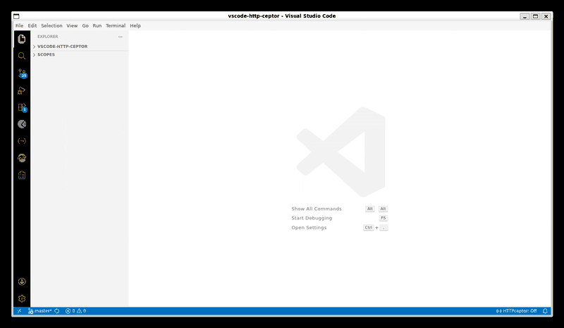

<p align="center">
  
</p>

# HTTPceptor

> Real-time HTTP/HTTPS traffic inspector built directly into VS Code. See every request made by every extension — no browser DevTools required.

HTTPceptor is a network traffic inspector that embeds [mitmproxy](https://mitmproxy.org/) directly into VS Code. It gives you a live, filterable network log — similar to the browser DevTools Network tab — but for the VS Code Extension Host process itself. Debug slow Postman collections, inspect GitLens API calls, or trace any HTTP traffic from any extension, all without leaving your editor.

<p align="center">

</p>

---

## Why I Built This

The Postman VS Code extension was taking 8+ seconds to load collections. No spinner, no error, no log — just silence. I opened every panel I could think of. Nothing showed the actual HTTP calls the extension was making under the hood.

The VS Code Extension Host runs in a Node.js process. There is no browser DevTools Network tab for it. You cannot attach Chrome DevTools to see outbound requests from other extensions. The only way to see what's happening is to intercept at the OS network level.

I tried setting `HTTP_PROXY` manually and pointing at mitmproxy. It worked — but required a terminal, a separate browser tab for the mitmweb UI, a VS Code restart, and trusting a CA cert by hand. Every single time.

HTTPceptor automates all of that. One click to start. One panel to watch. Zero context switching.

## Why HTTPceptor?

- **First of its kind**: No other extension on Open VSX or the VS Code Marketplace provides a DevTools-style Network tab for the Extension Host process.
- **Zero external tooling**: mitmproxy runs as a child process managed by the extension — no terminal, no separate browser tab needed.
- **Works with every extension**: Postman, GitLens, GitHub Copilot, REST Client, EchoAPI, APIxs, Bruno, HttpForge — if it makes HTTP calls, HTTPceptor sees them.
- **Initiator detection**: Each captured request shows which extension initiated it, so you can trace traffic back to its source.
- **Universal Compatibility**: Works with **VSCodium**, **Cursor**, **Windsurf**, and any VS Code-based IDE. Published to the **[Open VSX Registry](https://open-vsx.org/)**.
- **100% Local**: Traffic stays on your machine. No telemetry, no cloud, no account required.

---

## Key Features

### Live Network Panel
A real-time traffic log embedded directly in VS Code as a WebView panel.
- **Initiator column**: Shows which extension made each request (detected via stack traces, with User-Agent fallback).
- **Color-coded methods**: GET, POST, PUT, DELETE, PATCH each styled for instant recognition.
- **Status highlighting**: 2xx green, 4xx amber, 5xx red — spot failures instantly.
- **Request/Response detail**: Click any row to inspect headers, body, timing, and raw payload.
- **Auto-scroll**: Follows incoming traffic as it arrives, like a live log tail.

### Full HTTPS Interception
HTTPceptor intercepts TLS traffic — not just plain HTTP.
- **Automatic CA setup**: Detects and generates the mitmproxy CA certificate on first launch.
- **One-click trust**: Guides you through trusting the cert with a single action — no manual terminal steps.
- **NODE_EXTRA_CA_CERTS**: Injected automatically into VS Code terminal environment settings.

### Smart Binary Detection
HTTPceptor finds your local mitmproxy install automatically — no PATH configuration needed.
- Checks `httpceptor.mitmBinary` setting first (user-configured explicit path).
- Falls back to `which mitmdump` / `where mitmdump` system lookup.
- Probes well-known `pip install --user` locations across all platforms:
  - Linux: `~/.local/bin/mitmdump`
  - macOS: `~/Library/Python/3.x/bin/mitmdump`
  - Windows: `%APPDATA%\Python\Scripts\mitmdump.exe`

---

## Requirements

HTTPceptor requires **mitmproxy** to be installed on your system. It is not bundled.

```bash
pip install mitmproxy
```

Verify the install:
```bash
mitmdump --version
```

> **Python 3.10+** is required by mitmproxy. Check with `python3 --version`.

If `mitmdump` is not found on PATH after install (common with `pip install --user`), either set `httpceptor.mitmBinary` in settings or add the pip user bin directory to your PATH:

```bash
# Linux / macOS — add to ~/.bashrc or ~/.zshrc
export PATH="$HOME/.local/bin:$PATH"
```

---

## Installation

### For Open VSX-native IDEs (VSCodium, Windsurf, etc.)
Search for **HTTPceptor** in the Extensions view and click **Install**.

### For VS Code
1. Visit the **[HTTPceptor page on Open VSX](https://open-vsx.org/)**.
2. Click **Download** to get the `.vsix` file.
3. In VS Code open the Extensions view, click **...** (More Actions) → **Install from VSIX...**

---

## Getting Started

1. Install mitmproxy: `pip install mitmproxy`
2. Click the **HTTPceptor** status bar item or run **HTTPceptor: Start Proxy** from the Command Palette.
3. The extension starts mitmdump, applies proxy settings, and opens the traffic panel.
4. Watch requests appear in the panel in real time.

> No window reload is required. The extension patches the Node.js runtime in-process so traffic capture begins immediately.

---

## Command Palette

Open the Command Palette (`Ctrl+Shift+P` / `Cmd+Shift+P`) and type **HTTPceptor** to access:

| Command                   | Description                               |
| ------------------------- | ----------------------------------------- |
| `HTTPceptor: Start Proxy` | Start mitmdump and open the traffic panel |
| `HTTPceptor: Stop Proxy`  | Stop mitmdump and clean up proxy settings |
| `HTTPceptor: Open Panel`  | Re-open the traffic panel if closed       |

---

## Settings

| Setting                    | Description                                     | Default    |
| -------------------------- | ----------------------------------------------- | ---------- |
| `httpceptor.mitmBinary`    | Path or name for the `mitmdump` binary          | `mitmdump` |
| `httpceptor.mitmproxyPort` | Proxy listen port                               | `8080`     |
| `httpceptor.autoStart`     | Start proxy automatically when VS Code launches | `false`    |

---

## How It Works

```
┌─────────────────────────┐     ┌──────────────────────┐     ┌─────────────────────┐
│  Extension Host (Node)  │────▶│  mitmdump :8080       │────▶│  HTTPceptor Panel   │
│  Postman, GitLens, etc. │     │  bridge.py (JSON)     │     │  (WebView)          │
└─────────────────────────┘     └──────────────────────┘     └─────────────────────┘
```

- **bridge.py** — a mitmproxy add-on that hooks the `response` event and prints each captured flow as a single-line JSON object to stdout. It includes request/response headers, bodies, timing, and status codes. Binary bodies are Base64-encoded.
- **Node.js process manager** — spawns `mitmdump` as a child process, reads stdout line-by-line, parses each JSON payload, attaches initiator metadata, and forwards it to the WebView panel via `postMessage`.
- **WebView panel** — renders the live traffic log with filtering, row selection, and request/response detail inspection.

---

## What Happens When the Proxy Is Activated

This section documents every modification HTTPceptor makes to your VS Code environment when you start the proxy. Everything listed here is reversed when you stop the proxy.

### 1. mitmdump child process

HTTPceptor spawns `mitmdump` as a child process on `127.0.0.1:<port>` (default 8080). This is the local proxy that intercepts HTTP/HTTPS traffic. It runs only while the proxy is active and is killed when you stop it. The process uses the `--ssl-insecure` flag to accept upstream certificates without verification (required for intercepting HTTPS in a development context).

### 2. VS Code settings injection

The following VS Code settings are written **temporarily** while the proxy is active:

| Setting                        | Value set                                               | Scope                                 |
| ------------------------------ | ------------------------------------------------------- | ------------------------------------- |
| `http.proxy`                   | `http://127.0.0.1:<port>`                               | Global                                |
| `http.proxyStrictSSL`          | `false`                                                 | Global                                |
| `http.proxySupport`            | `fallback`                                              | Global                                |
| `terminal.integrated.env.<os>` | Adds `HTTP_PROXY`, `HTTPS_PROXY`, `NODE_EXTRA_CA_CERTS` | Workspace (or Global if no workspace) |

All of these settings are **removed** (reset to their previous values) when the proxy is stopped. The `http.proxySupport` is set to `fallback` rather than `on` to avoid conflicts with VS Code's built-in proxy agent that can break certain extensions.

### 3. Node.js runtime monkey patching

This is the core mechanism that allows HTTPceptor to capture traffic from **all** extensions — including those that explicitly bypass proxy environment variables (like Postman).

**What is patched:**

- **`http.Agent.prototype.createConnection`** — the low-level method Node.js calls to create a TCP socket for every HTTP request. Replaced with a function that routes the connection through the local mitmproxy instead of connecting directly to the target host.
- **`https.Agent.prototype.createConnection`** — same as above, but for HTTPS. The patched version opens a TCP connection to mitmproxy, sends an HTTP `CONNECT` request to establish a tunnel, then performs a TLS handshake through that tunnel.
- **`worker_threads.Worker` constructor** — wrapped to inject `HTTP_PROXY`, `HTTPS_PROXY`, and `NODE_EXTRA_CA_CERTS` environment variables into any Worker threads spawned by extensions (e.g., EchoAPI runs HTTP requests in worker threads).

**Why monkey patching is necessary:**

VS Code extensions run inside the Extension Host — a shared Node.js process. There is no API to intercept outbound network traffic. Setting `HTTP_PROXY` environment variables works for some extensions, but others (notably Postman) explicitly set `proxy: false` on their HTTP requests, bypassing all proxy environment variables. By patching at the `Agent.prototype.createConnection` level — the lowest point before a TCP socket is created — we intercept traffic regardless of what proxy settings individual libraries use.

**What is NOT patched:**

- `http.request` / `https.request` / `http.get` / `https.get` — these higher-level functions are not touched. Only the socket creation layer is modified.
- No global variables are modified (no `NODE_TLS_REJECT_UNAUTHORIZED`, no `global.fetch` override).
- No other extensions' code is modified on disk.

**Reversal:**

When the proxy is stopped (or the extension is deactivated), the original `createConnection` methods and `Worker` constructor are restored to their exact original references. The runtime returns to its unpatched state.

### 4. mitmproxy CA certificate

On first launch, if no mitmproxy CA certificate exists at `~/.mitmproxy/mitmproxy-ca-cert.pem`, HTTPceptor runs `mitmdump` briefly to generate it. This certificate is used by mitmproxy to sign intercepted HTTPS responses.

The certificate is made available to Node.js via the `NODE_EXTRA_CA_CERTS` environment variable (set in terminal environment settings and Worker thread environments). It is **not** installed into your operating system's trust store — it only affects the VS Code process.

### Summary of side effects

| What                               | When active                                              | After stop             |
| ---------------------------------- | -------------------------------------------------------- | ---------------------- |
| mitmdump process                   | Running on localhost                                     | Killed                 |
| `http.proxy` setting               | Set to local proxy URL                                   | Removed                |
| `http.proxyStrictSSL`              | Set to `false`                                           | Removed                |
| `http.proxySupport`                | Set to `fallback`                                        | Removed                |
| Terminal env vars                  | `HTTP_PROXY`, `HTTPS_PROXY`, `NODE_EXTRA_CA_CERTS` added | Removed                |
| `Agent.prototype.createConnection` | Patched on both `http` and `https`                       | Restored to original   |
| `worker_threads.Worker`            | Constructor wrapped                                      | Restored to original   |
| CA certificate                     | Generated at `~/.mitmproxy/` if missing                  | Left in place (reused) |

---

## Security & Privacy

- All traffic is intercepted **locally only** — nothing is sent to any server.
- The mitmproxy CA certificate is stored in `~/.mitmproxy/` and used only via `NODE_EXTRA_CA_CERTS` within the VS Code process. It is not installed system-wide.
- Stopping the proxy removes all injected settings and restores all runtime patches.
- HTTPceptor has **no telemetry**, **no analytics**, and **no network calls** of its own.
- The monkey patch operates at the socket creation level only — it does not read, modify, or store the content of intercepted requests. All traffic flows directly between the extension and mitmproxy.

---

## Known Limitations

- **Remote / SSH workspaces** are not supported — mitmdump runs locally only.
- **Binary response bodies** (images, PDFs) are captured as Base64 and displayed as a size indicator rather than rendered inline.
- **Worker thread isolation**: Extensions running HTTP in worker threads are covered via proxy environment variable injection, but the monkey patch itself only applies to the main Extension Host process.
- **VS Code proxy-agent conflict**: VS Code's built-in `@vscode/proxy-agent` may log `Protocol "https:" not supported` errors in the console when the proxy is active. These are caught internally and do not affect functionality.
- **VS Code CA trust**: VS Code sometimes do not trust CA certificate of mitmproxy, some images, request rejected (Dev Tools / Console errors).
  - installing mitmproxy CA sometimes helps: `sudo cp ~/.mitmproxy/mitmproxy-ca-cert.pem /usr/local/share/ca-certificates/mitmproxy.crt && sudo update-ca-certificates`
  - running VSCode with ignore certificate errors, eg `code --ignore-certificate-errors .`

---

License: MIT | Created by abridge
